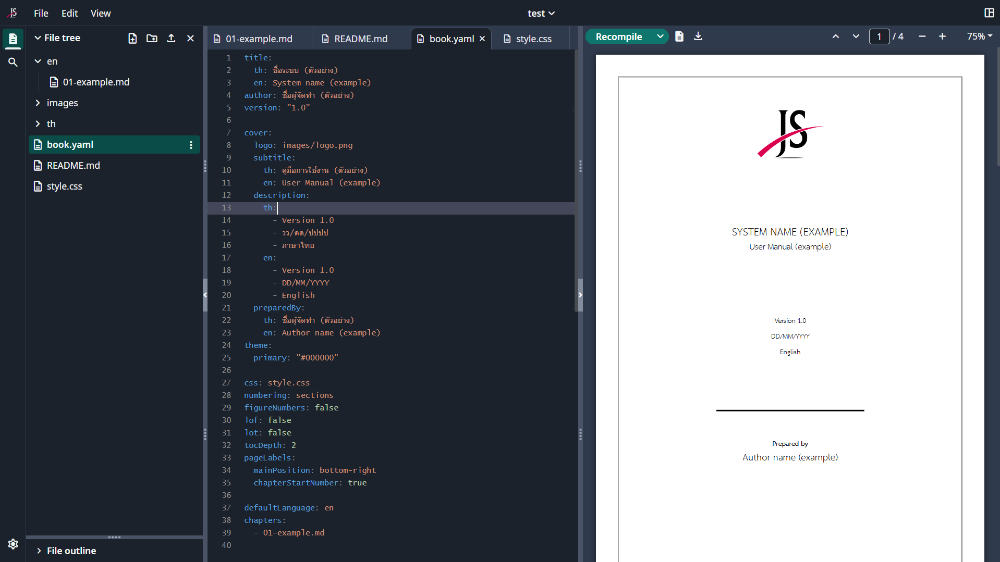

# Japan Documentation Studio

Japan Documentation Studio is an internal web app for writing and publishing Thai and English manuals from Markdown.



## Features

- Manage manuals as projects with a file tree, Markdown editor, and side-by-side PDF preview.
- Generate PDFs with a configurable cover, table of contents, and page numbers.
- Publish Thai and English editions from one project, with support for images, tables, and cross-references.

## How to use

1. Open Documentation Studio in your browser and select **New project** → **Blank project**.
2. Edit the sample Markdown chapter in `en/` or `th/`. To add a chapter, create a `.md` file and list it under `chapters` in `book.yaml`. Use matching filenames for bilingual chapters.
3. Set the title, cover, and `defaultLanguage` in `book.yaml`. Upload images to `images/` and edit `style.css` to customize the PDF layout.
4. Click **Recompile** to update the preview, then click **Download PDF**. If the build fails, open **Logs and output files** to see compiler messages.

## Test the compiler

The Markdown-to-PDF compiler lives in [`services/md-compile`](services/md-compile). Run its tests with Node.js and npm:

```sh
cd services/md-compile
npm ci
npm test
```
