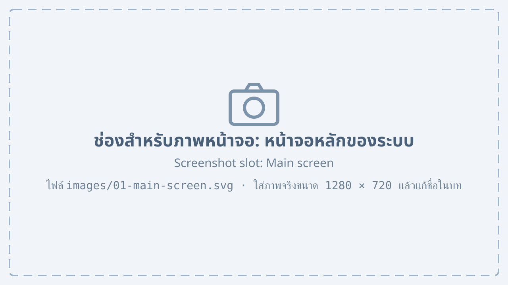

# System overview {#overview}

## About this manual {#about}

This manual explains how to use the factory management system for every group of users: signing in, issuing quotations, creating production orders, managing stock and purchasing, and issuing invoices and accounting reports. Each topic shows the screen with numbers that point to its important parts.

This manual uses these conventions:

1. Names of buttons, menus and fields are in quotation marks, for example the “Save” button.
2. Steps are numbered; follow them from top to bottom.
3. Text in a “Note” box is extra information.

::: note
Screens in this manual may differ slightly from the real screens, depending on your rights and the version of the system.
:::

## System requirements {#requirements}

The system runs in a web browser, so nothing has to be installed. The computer should meet @tbl-requirements.

| Item | Minimum | Recommended |
|---|---|---|
| Web browser | Latest Google Chrome or Microsoft Edge | Google Chrome |
| Screen resolution | 1366 × 768 | 1920 × 1080 |
| Connection | Factory network | Wired LAN |
| Printer | A4 printer | Laser printer |

: Requirements of the computer {#tbl-requirements}

## Parts of the main screen {#main-screen}

After signing in, the system shows the main screen, the starting point of every menu.

{#fig-main-screen}

@fig-main-screen shows the main screen, with these numbered parts:

1. The menu on the left, to choose a part of the system
2. The “Search” box, to find a document by number or customer name
3. The name of the signed-in user and the button to sign out
4. Boxes with pending work, such as quotations waiting for approval and unfinished production orders
5. Documents the user opened recently

## Main menus {#menus}

The menus a user sees depend on the rights of the user's group. @tbl-menus describes each menu.

| Menu | Purpose | Users |
|---|---|---|
| Quotations | Create, edit and send quotations to customers | Sales |
| Production orders | Create production orders and follow their status | Production |
| Stock | See the remaining products and materials | Warehouse |
| Purchasing | Order materials and receive goods | Purchasing |
| Accounts | Issue invoices and see reports | Accounting |

: Main menus of the system {#tbl-menus}
