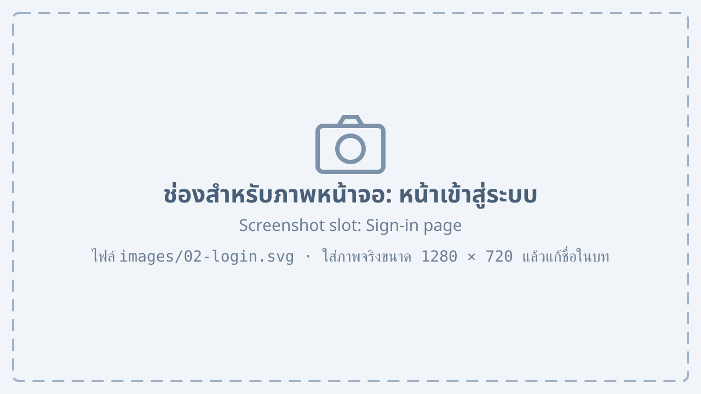
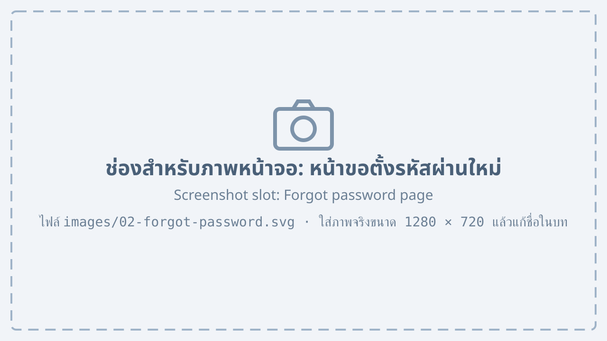
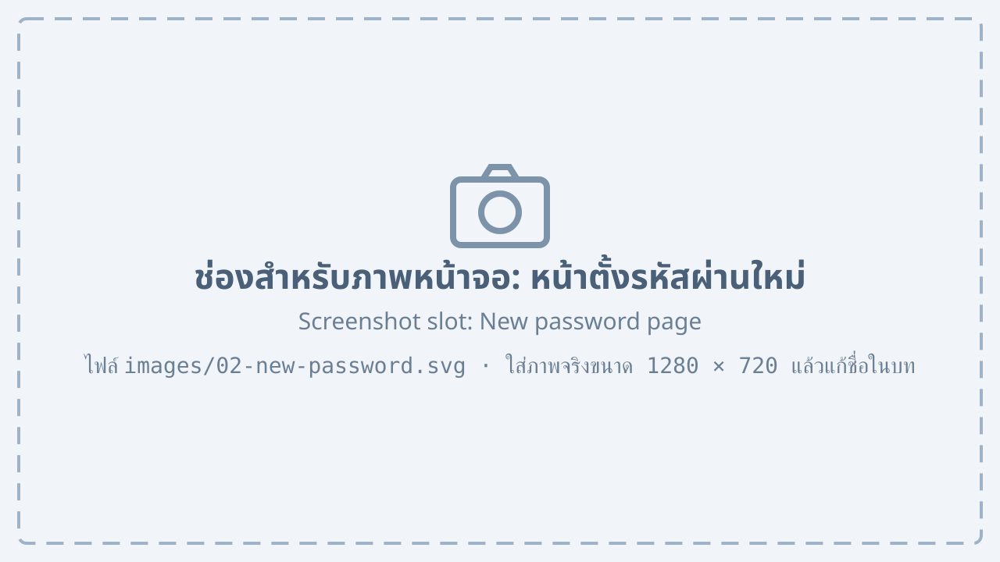

# Signing in {#login}

## Signing in {#sign-in}

To sign in:

1. Open a web browser and go to http://factory.local. The sign-in page appears.

    {#fig-login}

2. Enter the “Username” and “Password” you received from the administrator.
3. Press “Sign in”. The main screen appears.

@fig-login shows the sign-in page, with these numbered parts:

1. Username field
2. Password field
3. “Remember me”, so you do not have to sign in again on this computer
4. The “Sign in” button
    1. With correct details, the main screen opens
    2. With wrong details, a message appears under the password field
5. The “Forgot password” link, to set a new password

::: note
After 5 wrong passwords in a row, the account is locked for 15 minutes.
:::

## Setting a new password {#forgot-password}

If you forget your password, you can set a new one yourself:

1. Press “Forgot password” on the sign-in page.
2. Enter your registered e-mail address and press “Send link”.

    {#fig-forgot-password}

3. Open the e-mail from the system and press the link within 30 minutes.
4. Enter the new password twice and press “Save password”.

    {#fig-new-password}

As @fig-new-password shows, the new password must meet the rules in @tbl-password.

| Rule | Details |
|---|---|
| Length | At least 8 characters |
| Characters | Upper case, lower case and digits |
| No reuse | Not one of the last 3 passwords |

: Password rules {#tbl-password}

## Signing out {#sign-out}

1. Press your name at the top right of the screen.
2. Choose “Sign out”. The sign-in page appears again.

::: note
Always sign out on a computer you share with others.
:::
