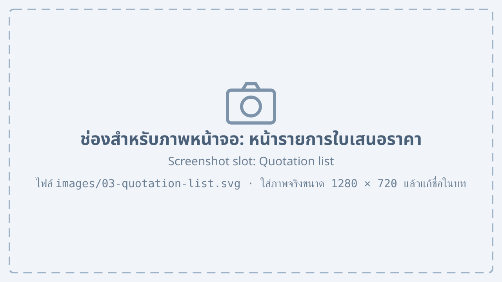
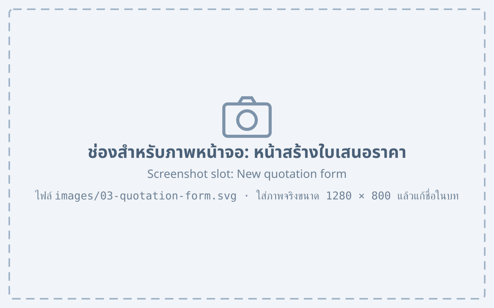
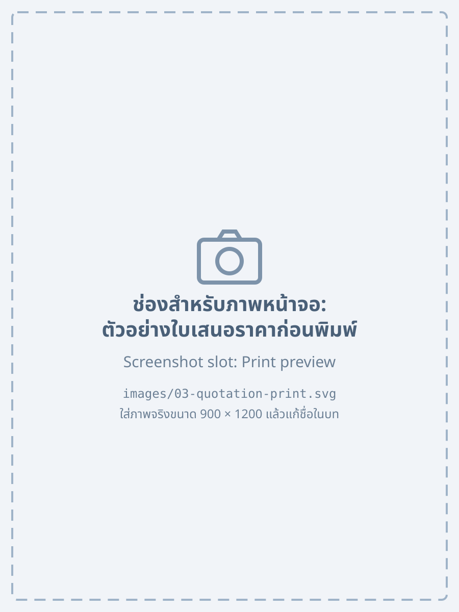

# Quotations {#quotation}

## Quotation list {#quotation-list}

Choose the “Quotations” menu to see all quotations you are allowed to see.

{#fig-quotation-list}

@fig-quotation-list shows the quotation list, with these numbered parts:

1. The “New quotation” button
2. The status filter, to show only quotations with the chosen status
3. The “Search” box, to find by number or customer name
4. The list of quotations with number, date, customer, total and status
5. Buttons to change the page of the list

@tbl-quotation-status explains the status of a quotation.

| Status | Meaning |
|---|---|
| Draft | Saved, not yet sent to the customer |
| Waiting for approval | Sent to the sales manager for approval |
| Sent | Sent to the customer, waiting for an answer |
| Accepted | The customer confirmed the order; a production order can be created |
| Cancelled | No longer used |

: Status of a quotation {#tbl-quotation-status}

## Creating a quotation {#quotation-new}

1. Press “New quotation” on the quotation list.
2. Choose the customer in “Customer”, or press “New customer” if the customer is not in the system yet.
3. Add the products
    1. Press “Add item”
    2. Choose the product and enter the quantity and discount
    3. Repeat for every item

    {#fig-quotation-form}

4. Check the total and press “Save”. The quotation number is created automatically.

The fields of the form in @fig-quotation-form are described in @tbl-quotation-fields.

| Field | Description | Required |
|---|---|---|
| Number | Created automatically, QT-yearmonth-sequence | – |
| Customer | The customer of the quotation | Yes |
| Valid until | Last day the prices apply, 30 days by default | Yes |
| Items | Product, quantity, unit price and discount | Yes |
| Remarks | Text printed at the end of the quotation | No |

: Fields of a quotation {#tbl-quotation-fields}

::: note
Unit prices come from the price list. For a special price, change “Discount” instead of the unit price.
:::

## Printing and sending a quotation {#quotation-print}

1. Open the quotation from the list.
2. Press “Print” to see a preview, or “Send e-mail” to send it to the customer as a PDF file.

    {#fig-quotation-print width=45%}

3. Once sent, the status changes to “Sent”.
