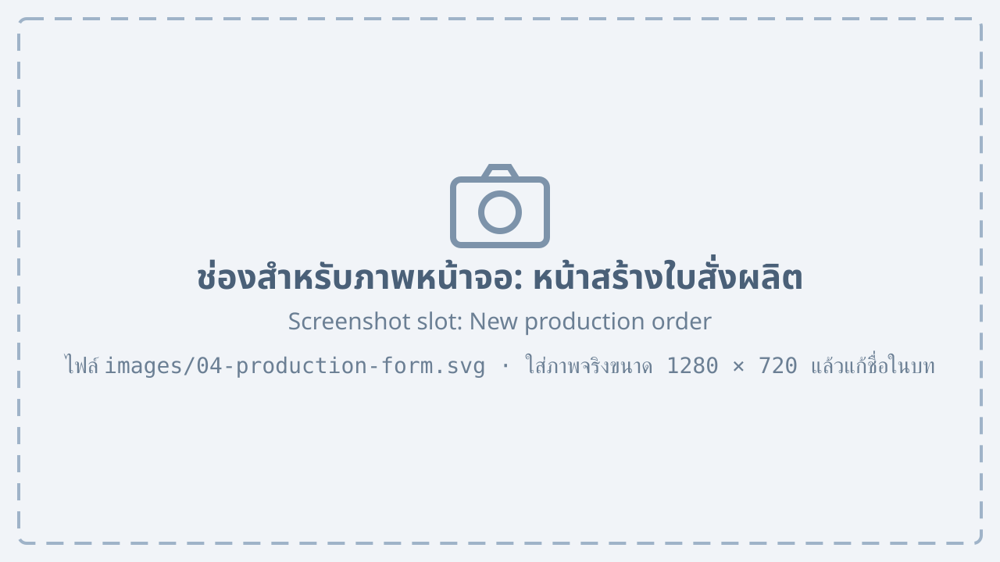
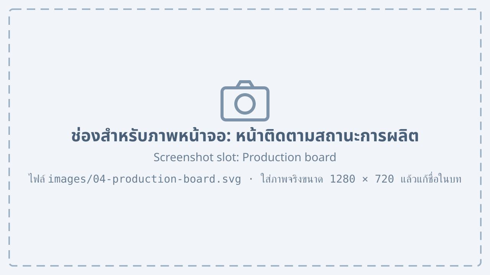

# Production orders {#production}

## Creating a production order from a quotation {#production-new}

When the customer confirms the order, sales can create a production order from the quotation without entering the items again.

1. Open a quotation with the status “Accepted”.
2. Press “Create production order”.
3. Choose the “Required date” and the “Production line”.

    {#fig-production-form}

4. Press “Send to production”.

@fig-production-form shows the new production order form, with these numbered parts:

1. Number of the quotation it comes from
2. Products and quantities to produce, taken from the quotation
3. The “Required date” field
4. The “Production line” field, to choose the line that does the work
5. The “Send to production” button

## Following production {#production-status}

Production changes the status of the order as the work moves on. Every department can see the status in the “Production orders” menu.

{#fig-production-board}

In @fig-production-board each order sits in the column of its status, see @tbl-production-status.

| Status | Meaning | Changed by |
|---|---|---|
| Waiting | Order received, work not started | System |
| In production | Work started on the production line | Line supervisor |
| Quality check | Finished, waiting for quality control | Quality control |
| Ready to ship | Passed quality control, waiting for delivery | Warehouse |

: Status of a production order {#tbl-production-status}

::: note
When an order becomes “Ready to ship”, the system adds the products to the stock automatically.
:::
