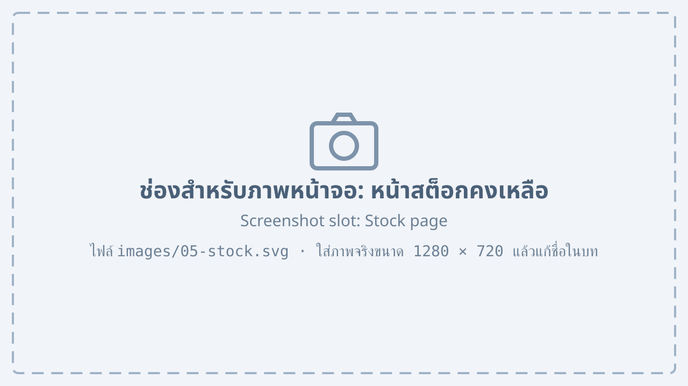
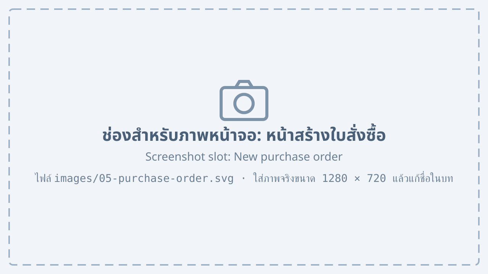

# Stock and purchasing {#stock}

## Checking the stock {#stock-view}

The “Stock” menu shows the remaining products and materials in each warehouse.

{#fig-stock}

@fig-stock shows the stock page, with these numbered parts:

1. The warehouse selector
2. The “Products” and “Materials” tabs
3. The table of quantity on hand, reserved quantity and available quantity
4. Items below the reorder point are shown in red

## Ordering materials {#purchase-order}

1. On the stock page, select the materials below the reorder point and press “Create purchase order”.
2. Choose the supplier and check the quantities the system suggests.

    {#fig-purchase-order}

3. Press “Send for approval” to send it to the purchasing manager.
4. After approval, press “Send to supplier”.

## Receiving goods {#goods-receipt}

When the goods arrive, the warehouse records them:

1. Open a purchase order with the status “Waiting for goods”.
2. Press “Receive goods”.
3. Enter the quantity actually received for each item
    1. If everything arrived, the purchase order is closed
    2. If something is missing, the order stays “Waiting for goods” for the rest
4. Press “Save”. The stock is updated at once.

::: note
Check the goods before saving. Enter damaged goods in “Quantity returned”.
:::
