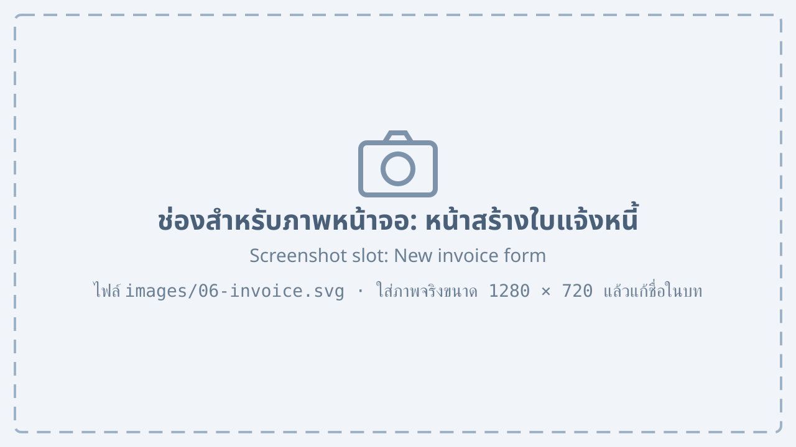
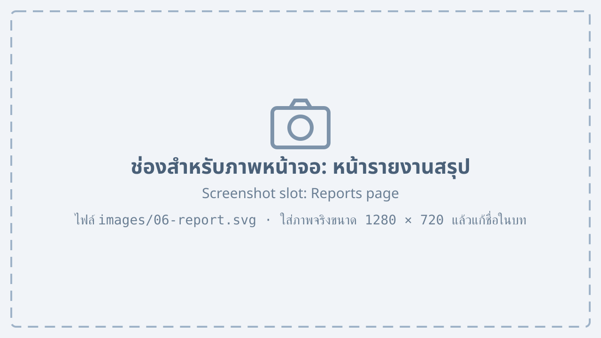

# Accounts and reports {#accounting}

## Issuing an invoice {#invoice}

1. Choose the “Accounts” menu, then “Invoices”.
2. Press “Create from production order” and choose an order that is “Ready to ship”.

    {#fig-invoice}

3. Check the items, the VAT and the payment terms.
4. Press “Issue invoice”.

@fig-invoice shows the new invoice form, with these numbered parts:

1. Customer details and billing address
2. Items from the production order
3. Amount before tax, 7% VAT and net amount
4. The “Payment terms” field
5. The “Issue invoice” button

## Reports {#reports}

The “Reports” menu gives an overview of sales, production and expenses for a chosen period.

{#fig-report}

@tbl-reports lists the reports in the system.

| Report | Shows | Suggested period |
|---|---|---|
| Sales | Sales by customer and product | Monthly |
| Production | Quantity produced and time used by each line | Weekly |
| Stock | Value of stock and its movements | Monthly |
| Receivables | Invoices not yet paid | Weekly |

: Reports in the system {#tbl-reports}

## Exporting a report {#report-export}

1. Open the report and choose the dates.
2. Press “Export” and choose “Excel” or “PDF”.
3. The file is downloaded to your computer.

::: note
A report of more than 12 months may take more than a minute to create.
:::
