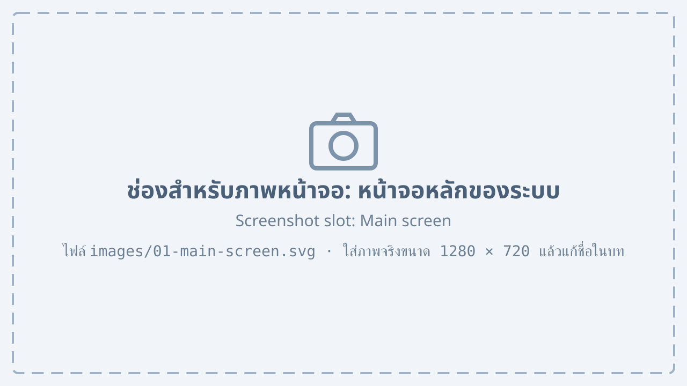

# ภาพรวมระบบ {#overview}

## เกี่ยวกับคู่มือนี้ {#about}

คู่มือฉบับนี้อธิบายการใช้งานระบบบริหารจัดการโรงงานสำหรับผู้ใช้งานทุกกลุ่ม ตั้งแต่การเข้าสู่ระบบ การออกใบเสนอราคา การสร้างใบสั่งผลิต การจัดการสต็อกและการจัดซื้อ ไปจนถึงการออกใบแจ้งหนี้และรายงานทางบัญชี แต่ละหัวข้อจะแสดงภาพหน้าจอประกอบพร้อมหมายเลขกำกับส่วนสำคัญของหน้าจอนั้น

ในคู่มือนี้ใช้รูปแบบการเขียนดังต่อไปนี้

1. ชื่อปุ่ม เมนู และช่องกรอกข้อมูล เขียนอยู่ในเครื่องหมายคำพูด เช่น ปุ่ม “บันทึก”
2. ขั้นตอนการทำงานเรียงตามหมายเลข ให้ทำตามลำดับจากบนลงล่าง
3. ข้อความในกล่อง “หมายเหตุ” เป็นข้อควรรู้เพิ่มเติม

::: note
ภาพหน้าจอในคู่มืออาจแตกต่างจากหน้าจอจริงเล็กน้อย ขึ้นอยู่กับสิทธิ์ของผู้ใช้และเวอร์ชันของระบบ
:::

## ความต้องการของระบบ {#requirements}

ระบบทำงานผ่านเว็บเบราว์เซอร์ จึงไม่ต้องติดตั้งโปรแกรมเพิ่มเติม อุปกรณ์ที่ใช้งานควรมีคุณสมบัติตาม @tbl-requirements

| รายการ | ความต้องการขั้นต่ำ | ที่แนะนำ |
|---|---|---|
| เว็บเบราว์เซอร์ | Google Chrome หรือ Microsoft Edge รุ่นล่าสุด | Google Chrome |
| ความละเอียดหน้าจอ | 1366 × 768 | 1920 × 1080 |
| การเชื่อมต่อ | เครือข่ายภายในโรงงาน | สาย LAN |
| เครื่องพิมพ์ | เครื่องพิมพ์ A4 | เครื่องพิมพ์เลเซอร์ |

: ความต้องการของอุปกรณ์ที่ใช้งาน {#tbl-requirements}

## ส่วนประกอบของหน้าจอหลัก {#main-screen}

เมื่อเข้าสู่ระบบสำเร็จ ระบบจะแสดงหน้าจอหลักซึ่งเป็นจุดเริ่มต้นของการทำงานทุกเมนู

{#fig-main-screen}

จาก @fig-main-screen แสดงหน้าจอหลักของระบบ ซึ่งประกอบด้วยหมายเลขที่ระบุดังนี้

1. แถบเมนูด้านซ้าย สำหรับเลือกเมนูการทำงานของระบบ
2. ช่อง “ค้นหา” สำหรับค้นหาเอกสารด้วยเลขที่หรือชื่อลูกค้า
3. ชื่อผู้ใช้งานที่เข้าสู่ระบบอยู่ และปุ่มสำหรับออกจากระบบ
4. กล่องสรุปงานค้าง เช่น ใบเสนอราคาที่รออนุมัติ และใบสั่งผลิตที่ยังไม่เสร็จ
5. รายการเอกสารล่าสุดที่ผู้ใช้เปิดดู

## เมนูหลักของระบบ {#menus}

เมนูที่ผู้ใช้เห็นขึ้นอยู่กับสิทธิ์ของกลุ่มผู้ใช้ รายละเอียดของแต่ละเมนูแสดงใน @tbl-menus

| เมนู | หน้าที่ | ผู้ใช้ที่เกี่ยวข้อง |
|---|---|---|
| ใบเสนอราคา | สร้าง แก้ไข และส่งใบเสนอราคาให้ลูกค้า | ฝ่ายขาย |
| ใบสั่งผลิต | สร้างใบสั่งผลิตและติดตามสถานะการผลิต | ฝ่ายผลิต |
| สต็อก | ดูจำนวนสินค้าและวัตถุดิบคงเหลือ | ฝ่ายคลังสินค้า |
| จัดซื้อ | ออกใบสั่งซื้อวัตถุดิบและรับสินค้าเข้า | ฝ่ายจัดซื้อ |
| บัญชี | ออกใบแจ้งหนี้และดูรายงานสรุป | ฝ่ายบัญชี |

: เมนูหลักของระบบ {#tbl-menus}
