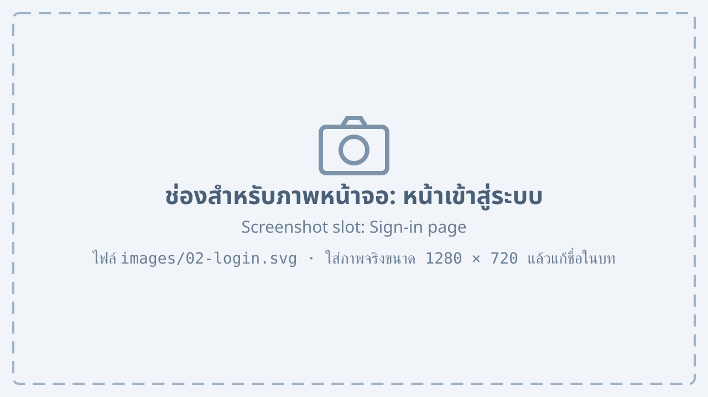
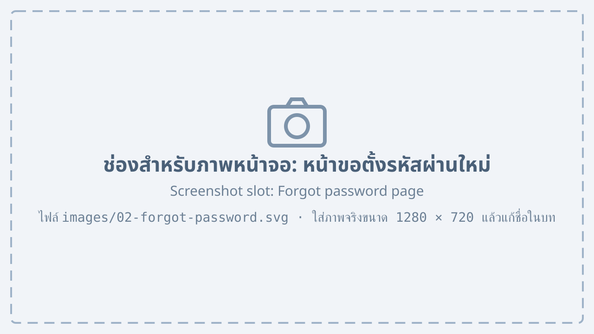
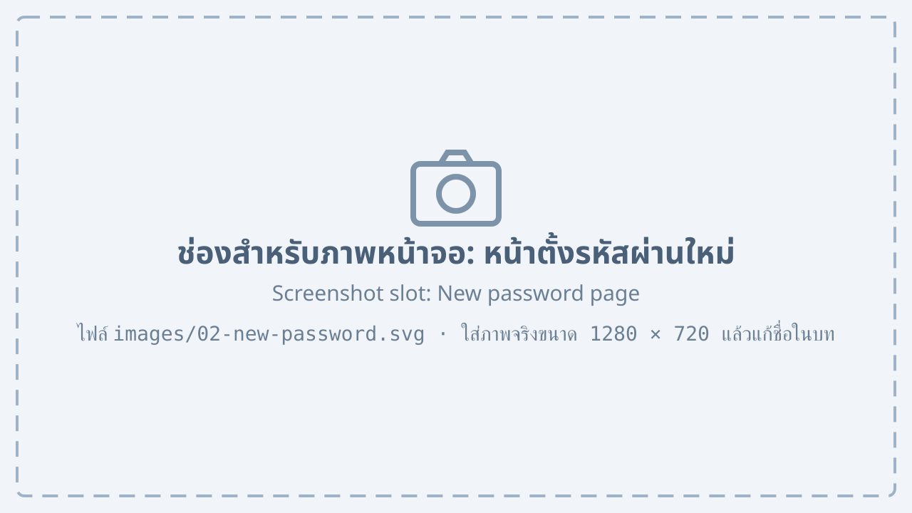

# การเข้าสู่ระบบ {#login}

## การเข้าสู่ระบบ {#sign-in}

การเข้าสู่ระบบมีขั้นตอนดังต่อไปนี้

1. เปิดเว็บเบราว์เซอร์แล้วเข้าไปที่ http://factory.local ระบบจะแสดงหน้าเข้าสู่ระบบ

    {#fig-login}

2. กรอก “ชื่อผู้ใช้” และ “รหัสผ่าน” ที่ได้รับจากผู้ดูแลระบบ
3. กดปุ่ม “เข้าสู่ระบบ” ระบบจะแสดงหน้าจอหลัก

จาก @fig-login แสดงหน้าเข้าสู่ระบบ ซึ่งประกอบด้วยหมายเลขที่ระบุดังนี้

1. ช่องสำหรับกรอกชื่อผู้ใช้ (Username)
2. ช่องสำหรับกรอกรหัสผ่าน (Password)
3. ช่อง “จดจำฉันไว้” สำหรับไม่ต้องเข้าสู่ระบบใหม่ในเครื่องเดิม
4. ปุ่ม “เข้าสู่ระบบ” เพื่อยืนยันการเข้าสู่ระบบ
    1. ถ้ากรอกข้อมูลถูกต้อง ระบบจะเข้าสู่หน้าจอหลัก
    2. ถ้ากรอกข้อมูลผิด ระบบจะแสดงข้อความแจ้งเตือนใต้ช่องรหัสผ่าน
5. ลิงก์ “ลืมรหัสผ่าน” สำหรับขอตั้งรหัสผ่านใหม่

::: note
ถ้ากรอกรหัสผ่านผิดติดต่อกัน 5 ครั้ง บัญชีจะถูกระงับชั่วคราว 15 นาที
:::

## การขอตั้งรหัสผ่านใหม่ {#forgot-password}

กรณีที่ผู้ใช้จำรหัสผ่านไม่ได้ สามารถขอตั้งรหัสผ่านใหม่ได้ด้วยตนเองตามขั้นตอนต่อไปนี้

1. กดลิงก์ “ลืมรหัสผ่าน” ที่หน้าเข้าสู่ระบบ
2. กรอกอีเมลที่ลงทะเบียนไว้ แล้วกดปุ่ม “ส่งลิงก์”

    {#fig-forgot-password}

3. เปิดอีเมลจากระบบแล้วกดลิงก์ภายใน 30 นาที
4. กรอกรหัสผ่านใหม่ 2 ครั้งให้ตรงกัน แล้วกดปุ่ม “บันทึกรหัสผ่าน”

    {#fig-new-password}

จาก @fig-new-password รหัสผ่านใหม่ต้องเป็นไปตามเงื่อนไขใน @tbl-password

| เงื่อนไข | รายละเอียด |
|---|---|
| ความยาว | อย่างน้อย 8 ตัวอักษร |
| ตัวอักษร | ต้องมีทั้งตัวพิมพ์ใหญ่ ตัวพิมพ์เล็ก และตัวเลข |
| ห้ามซ้ำ | ต้องไม่ซ้ำกับรหัสผ่าน 3 ครั้งล่าสุด |

: เงื่อนไขของรหัสผ่าน {#tbl-password}

## การออกจากระบบ {#sign-out}

1. กดชื่อผู้ใช้ที่มุมขวาบนของหน้าจอ
2. เลือก “ออกจากระบบ” ระบบจะกลับไปที่หน้าเข้าสู่ระบบ

::: note
ควรออกจากระบบทุกครั้งเมื่อใช้เครื่องคอมพิวเตอร์ร่วมกับผู้อื่น
:::
