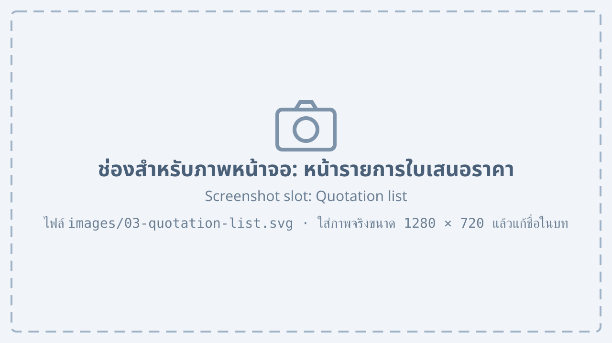
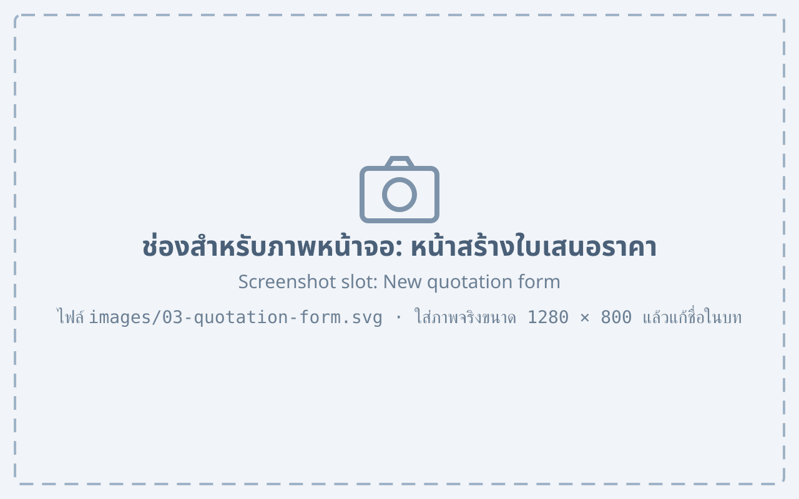
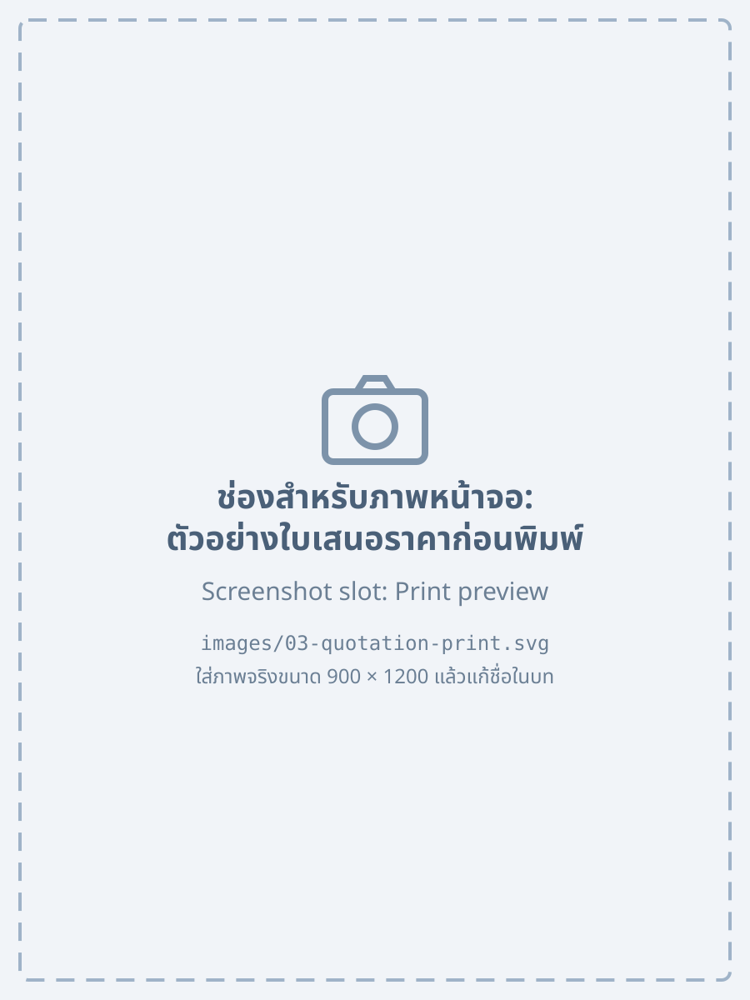

# ใบเสนอราคา {#quotation}

## รายการใบเสนอราคา {#quotation-list}

เมื่อเลือกเมนู “ใบเสนอราคา” ระบบจะแสดงรายการใบเสนอราคาทั้งหมดที่ผู้ใช้มีสิทธิ์ดู

{#fig-quotation-list}

จาก @fig-quotation-list แสดงหน้ารายการใบเสนอราคา ซึ่งประกอบด้วยหมายเลขที่ระบุดังนี้

1. ปุ่ม “สร้างใบเสนอราคา” สำหรับสร้างใบเสนอราคาใหม่
2. ตัวกรองสถานะ สำหรับแสดงเฉพาะใบเสนอราคาตามสถานะที่เลือก
3. ช่อง “ค้นหา” สำหรับค้นหาด้วยเลขที่หรือชื่อลูกค้า
4. ตารางรายการใบเสนอราคา แสดงเลขที่ วันที่ ลูกค้า ยอดรวม และสถานะ
5. ปุ่มเปลี่ยนหน้าของรายการ

สถานะของใบเสนอราคามีความหมายตาม @tbl-quotation-status

| สถานะ | ความหมาย |
|---|---|
| ร่าง | บันทึกไว้แล้ว แต่ยังไม่ได้ส่งให้ลูกค้า |
| รออนุมัติ | ส่งให้หัวหน้าฝ่ายขายอนุมัติ |
| ส่งแล้ว | ส่งให้ลูกค้าแล้ว รอการตอบรับ |
| ตอบรับ | ลูกค้ายืนยันการสั่งซื้อ สร้างใบสั่งผลิตได้ |
| ยกเลิก | ไม่ใช้งานแล้ว |

: สถานะของใบเสนอราคา {#tbl-quotation-status}

## การสร้างใบเสนอราคา {#quotation-new}

1. กดปุ่ม “สร้างใบเสนอราคา” ที่หน้ารายการใบเสนอราคา
2. เลือกลูกค้าจากช่อง “ลูกค้า” หรือกด “เพิ่มลูกค้าใหม่” ถ้ายังไม่มีในระบบ
3. เพิ่มรายการสินค้า
    1. กดปุ่ม “เพิ่มรายการ”
    2. เลือกสินค้า แล้วกรอกจำนวนและส่วนลด
    3. ทำซ้ำจนครบทุกรายการ

    {#fig-quotation-form}

4. ตรวจสอบยอดรวม แล้วกดปุ่ม “บันทึก” ระบบจะสร้างเลขที่ใบเสนอราคาให้อัตโนมัติ

จาก @fig-quotation-form ช่องข้อมูลของใบเสนอราคามีรายละเอียดตาม @tbl-quotation-fields

| ช่องข้อมูล | คำอธิบาย | จำเป็น |
|---|---|---|
| เลขที่ | ระบบสร้างให้อัตโนมัติ รูปแบบ QT-ปีเดือน-ลำดับ | – |
| ลูกค้า | ชื่อลูกค้าที่จะเสนอราคา | ใช่ |
| วันที่หมดอายุ | วันสุดท้ายที่ราคานี้ใช้ได้ ค่าเริ่มต้น 30 วัน | ใช่ |
| รายการสินค้า | สินค้า จำนวน ราคาต่อหน่วย และส่วนลด | ใช่ |
| หมายเหตุ | ข้อความที่จะพิมพ์ท้ายใบเสนอราคา | ไม่ |

: ช่องข้อมูลของใบเสนอราคา {#tbl-quotation-fields}

::: note
ราคาต่อหน่วยดึงจากรายการราคาสินค้าโดยอัตโนมัติ ถ้าต้องการราคาพิเศษให้แก้ในช่อง “ส่วนลด” แทนการแก้ราคาต่อหน่วย
:::

## การพิมพ์และส่งใบเสนอราคา {#quotation-print}

1. เปิดใบเสนอราคาที่ต้องการจากหน้ารายการ
2. กดปุ่ม “พิมพ์” เพื่อดูตัวอย่างก่อนพิมพ์ หรือกดปุ่ม “ส่งอีเมล” เพื่อส่งให้ลูกค้าเป็นไฟล์ PDF

    {#fig-quotation-print width=45%}

3. เมื่อส่งแล้ว ระบบจะเปลี่ยนสถานะเป็น “ส่งแล้ว”
