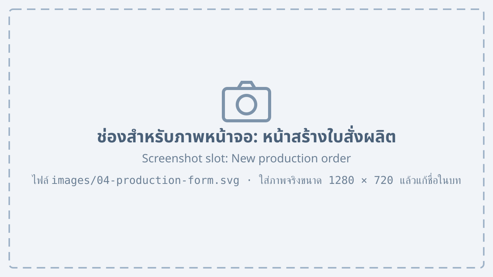
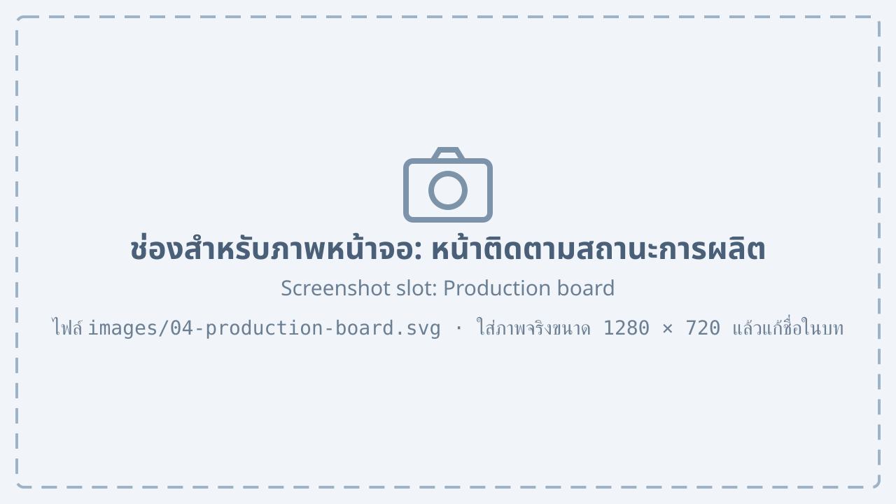

# ใบสั่งผลิต {#production}

## การสร้างใบสั่งผลิตจากใบเสนอราคา {#production-new}

เมื่อลูกค้ายืนยันการสั่งซื้อ ฝ่ายขายสามารถสร้างใบสั่งผลิตจากใบเสนอราคาได้ทันที โดยไม่ต้องกรอกรายการสินค้าใหม่

1. เปิดใบเสนอราคาที่มีสถานะ “ตอบรับ”
2. กดปุ่ม “สร้างใบสั่งผลิต”
3. เลือก “วันที่ต้องการสินค้า” และ “สายการผลิต”

    {#fig-production-form}

4. กดปุ่ม “ส่งไปฝ่ายผลิต”

จาก @fig-production-form แสดงหน้าสร้างใบสั่งผลิต ซึ่งประกอบด้วยหมายเลขที่ระบุดังนี้

1. เลขที่ใบเสนอราคาที่ใช้อ้างอิง
2. รายการสินค้าและจำนวนที่ต้องผลิต ซึ่งดึงมาจากใบเสนอราคา
3. ช่อง “วันที่ต้องการสินค้า”
4. ช่อง “สายการผลิต” สำหรับเลือกสายการผลิตที่จะรับงาน
5. ปุ่ม “ส่งไปฝ่ายผลิต”

## การติดตามสถานะการผลิต {#production-status}

ฝ่ายผลิตจะปรับสถานะของใบสั่งผลิตตามความคืบหน้าของงาน ผู้ใช้ทุกฝ่ายดูสถานะได้ที่เมนู “ใบสั่งผลิต”

{#fig-production-board}

จาก @fig-production-board ใบสั่งผลิตแต่ละใบจะอยู่ในคอลัมน์ตามสถานะใน @tbl-production-status

| สถานะ | ความหมาย | ผู้ปรับสถานะ |
|---|---|---|
| รอผลิต | ได้รับใบสั่งผลิตแล้ว ยังไม่เริ่มงาน | ระบบ |
| กำลังผลิต | เริ่มผลิตในสายการผลิตแล้ว | หัวหน้าสายการผลิต |
| ตรวจคุณภาพ | ผลิตเสร็จ รอการตรวจคุณภาพ | ฝ่ายควบคุมคุณภาพ |
| พร้อมส่ง | ผ่านการตรวจคุณภาพ รอจัดส่ง | ฝ่ายคลังสินค้า |

: สถานะของใบสั่งผลิต {#tbl-production-status}

::: note
เมื่อใบสั่งผลิตเปลี่ยนเป็น “พร้อมส่ง” ระบบจะเพิ่มจำนวนสินค้าในสต็อกให้อัตโนมัติ
:::
