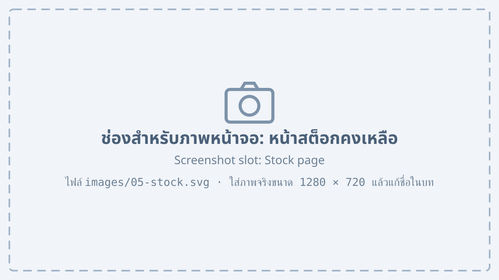
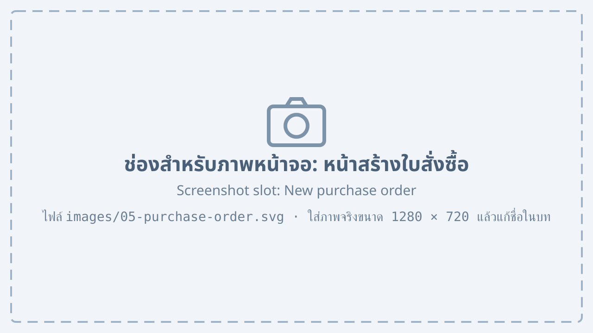

# สต็อกและการจัดซื้อ {#stock}

## การดูสต็อกคงเหลือ {#stock-view}

เมนู “สต็อก” แสดงจำนวนสินค้าและวัตถุดิบคงเหลือในแต่ละคลัง

{#fig-stock}

จาก @fig-stock แสดงหน้าสต็อกคงเหลือ ซึ่งประกอบด้วยหมายเลขที่ระบุดังนี้

1. ตัวเลือกคลังสินค้า
2. แถบเลือก “สินค้า” หรือ “วัตถุดิบ”
3. ตารางจำนวนคงเหลือ จำนวนที่จองไว้ และจำนวนที่พร้อมใช้
4. รายการที่ต่ำกว่าจุดสั่งซื้อจะแสดงเป็นสีแดง

## การออกใบสั่งซื้อวัตถุดิบ {#purchase-order}

1. ที่หน้าสต็อก เลือกวัตถุดิบที่ต่ำกว่าจุดสั่งซื้อ แล้วกดปุ่ม “สร้างใบสั่งซื้อ”
2. เลือกผู้จำหน่าย และตรวจสอบจำนวนที่ระบบเสนอ

    {#fig-purchase-order}

3. กดปุ่ม “ส่งอนุมัติ” เพื่อส่งให้ผู้จัดการฝ่ายจัดซื้ออนุมัติ
4. เมื่ออนุมัติแล้ว กดปุ่ม “ส่งให้ผู้จำหน่าย”

## การรับสินค้าเข้าคลัง {#goods-receipt}

เมื่อผู้จำหน่ายส่งของมาถึง ฝ่ายคลังสินค้าบันทึกการรับสินค้าตามขั้นตอนต่อไปนี้

1. เปิดใบสั่งซื้อที่มีสถานะ “รอรับสินค้า”
2. กดปุ่ม “รับสินค้า”
3. กรอกจำนวนที่ได้รับจริงของแต่ละรายการ
    1. ถ้าได้รับครบ ระบบจะปิดใบสั่งซื้อ
    2. ถ้าได้รับไม่ครบ ใบสั่งซื้อจะยังคงสถานะ “รอรับสินค้า” สำหรับส่วนที่เหลือ
4. กดปุ่ม “บันทึก” ระบบจะเพิ่มจำนวนในสต็อกทันที

::: note
ตรวจสอบสภาพสินค้าก่อนบันทึกรับทุกครั้ง สินค้าที่ชำรุดให้บันทึกในช่อง “จำนวนที่ส่งคืน”
:::
