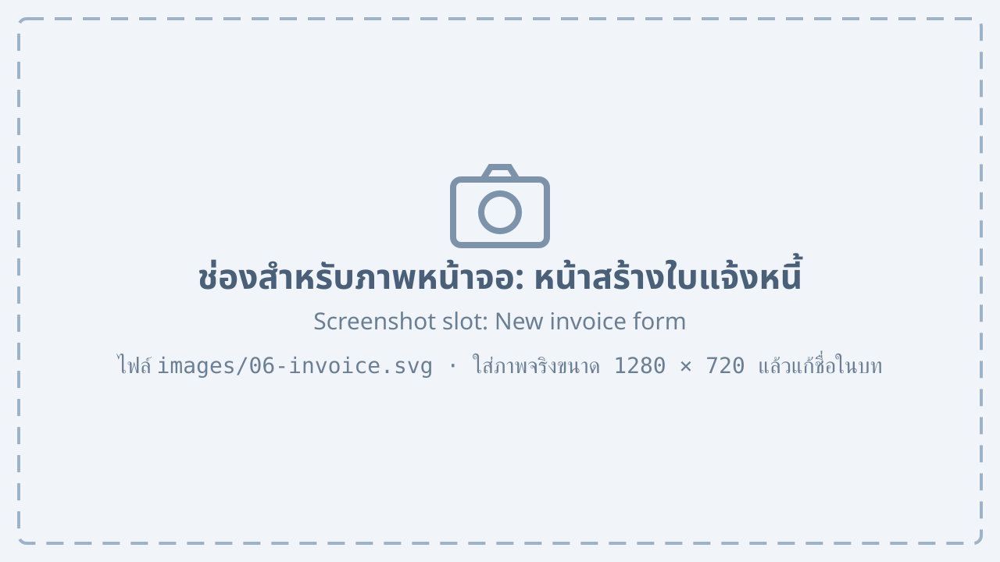
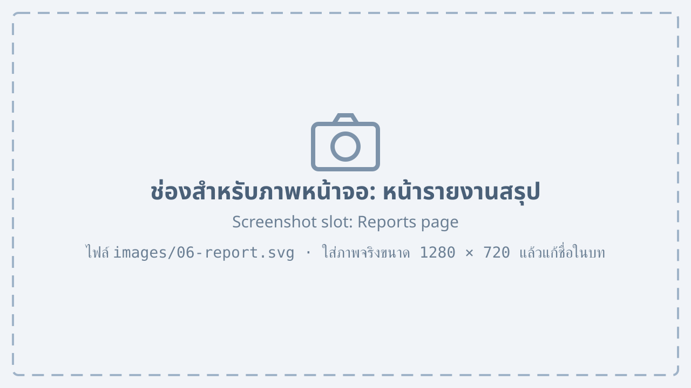

# บัญชีและรายงาน {#accounting}

## การออกใบแจ้งหนี้ {#invoice}

1. เลือกเมนู “บัญชี” แล้วเลือก “ใบแจ้งหนี้”
2. กดปุ่ม “สร้างจากใบสั่งผลิต” แล้วเลือกใบสั่งผลิตที่มีสถานะ “พร้อมส่ง”

    {#fig-invoice}

3. ตรวจสอบรายการ ภาษีมูลค่าเพิ่ม และเงื่อนไขการชำระเงิน
4. กดปุ่ม “ออกใบแจ้งหนี้”

จาก @fig-invoice แสดงหน้าสร้างใบแจ้งหนี้ ซึ่งประกอบด้วยหมายเลขที่ระบุดังนี้

1. ข้อมูลลูกค้าและที่อยู่สำหรับออกใบแจ้งหนี้
2. รายการสินค้าตามใบสั่งผลิต
3. ยอดก่อนภาษี ภาษีมูลค่าเพิ่ม 7% และยอดสุทธิ
4. ช่อง “เงื่อนไขการชำระเงิน”
5. ปุ่ม “ออกใบแจ้งหนี้”

## รายงานสรุป {#reports}

เมนู “รายงาน” แสดงภาพรวมยอดขาย การผลิต และค่าใช้จ่ายตามช่วงเวลาที่เลือก

{#fig-report}

รายงานที่มีในระบบแสดงใน @tbl-reports

| รายงาน | ข้อมูลที่แสดง | รอบที่แนะนำ |
|---|---|---|
| ยอดขาย | ยอดขายแยกตามลูกค้าและสินค้า | รายเดือน |
| การผลิต | จำนวนที่ผลิตได้และเวลาที่ใช้ของแต่ละสายการผลิต | รายสัปดาห์ |
| สต็อก | มูลค่าสินค้าคงเหลือและการเคลื่อนไหว | รายเดือน |
| ลูกหนี้ | ใบแจ้งหนี้ที่ยังไม่ได้รับชำระ | รายสัปดาห์ |

: รายงานในระบบ {#tbl-reports}

## การส่งออกรายงาน {#report-export}

1. เปิดรายงานที่ต้องการ แล้วเลือกช่วงวันที่
2. กดปุ่ม “ส่งออก” แล้วเลือกรูปแบบไฟล์ “Excel” หรือ “PDF”
3. ระบบจะดาวน์โหลดไฟล์ลงเครื่องคอมพิวเตอร์

::: note
รายงานที่มีข้อมูลมากกว่า 12 เดือนอาจใช้เวลาสร้างไฟล์นานกว่า 1 นาที
:::
