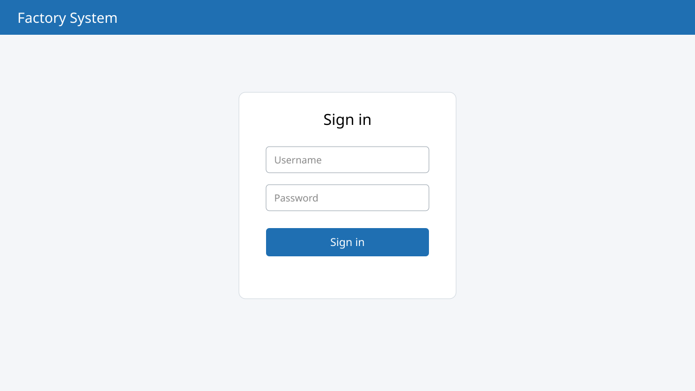

# Signing in {#login}

## First use {#first-use}

To start using the factory management system:

1. Open a web browser and go to http://localhost:3000. The sign-in page appears.

    {#fig-login}

@fig-login shows the sign-in page, with these numbered parts:

1. Username field
2. Password field
3. The “Sign in” button
    1. With correct details, the home page opens
    2. With wrong details, an error message is shown

::: note
If you forget your password, ask the administrator to reset it.
:::

### User roles {#roles}

Each group of users has different rights, see @tbl-roles.

| Group | Rights |
|---|---|
| Administrator | Manage users and all settings |
| Sales | Create and edit quotations |
| Accounting | View reports and issue invoices |

: Rights of each user group {#tbl-roles}
