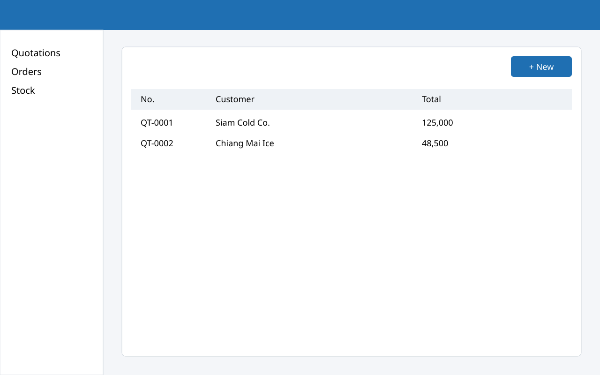
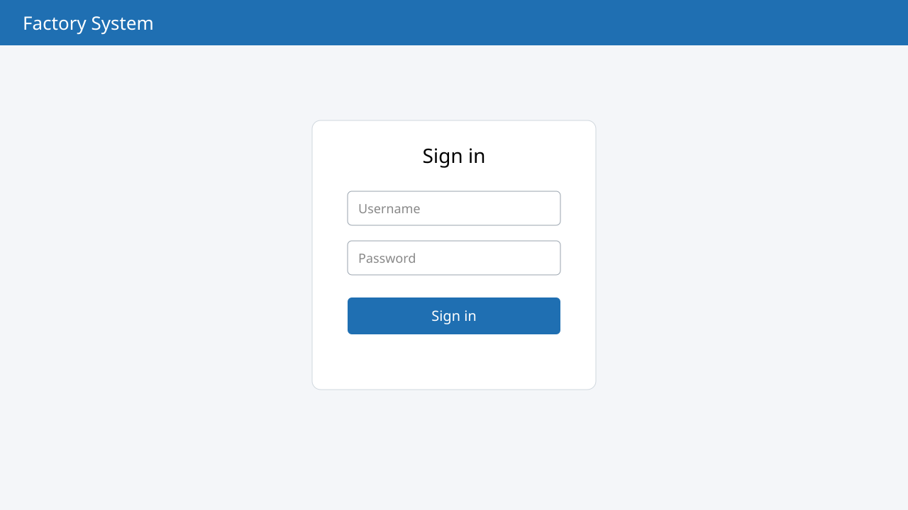

# Quotations {#quotation}

## Quotation list {#quotation-list}

Choose the “Quotations” menu to see all quotations.

{#fig-quotation}

@fig-quotation shows the quotation list, with these numbered parts:

1. The menu on the left
2. The “+ New” button to create a quotation
3. The table with number, customer and total

## Creating a quotation {#quotation-new}

1. Press “+ New” at the top right of the list
2. Enter the customer and the items
3. Press “Save”; the quotation number is created automatically

    {#fig-small width=50%}
