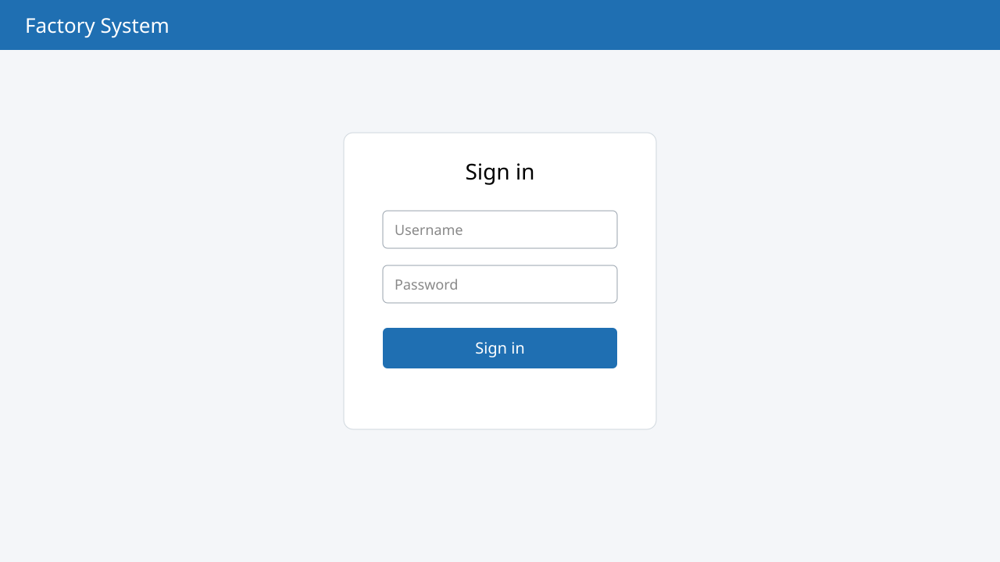

# การเข้าสู่ระบบ {#login}

## การเข้าใช้งานครั้งแรก {#first-use}

การเข้าใช้งานระบบบริหารจัดการโรงงานมีขั้นตอนดังต่อไปนี้

1. เปิดเว็บเบราว์เซอร์แล้วเข้าไปที่ http://localhost:3000 ระบบจะแสดงหน้าเข้าสู่ระบบ

    {#fig-login}

จาก @fig-login แสดงหน้าเข้าสู่ระบบ ซึ่งประกอบด้วยหมายเลขที่ระบุดังนี้

1. ช่องสำหรับกรอกชื่อผู้ใช้ (Username)
2. ช่องสำหรับกรอกรหัสผ่าน (Password)
3. ปุ่ม “เข้าสู่ระบบ” เพื่อยืนยันการเข้าสู่ระบบ
    1. ถ้ากรอกถูกต้อง ระบบจะเข้าสู่หน้าหลัก
    2. ถ้ากรอกผิด ระบบจะแสดงข้อความแจ้งเตือน

::: note
ถ้าลืมรหัสผ่าน ให้ติดต่อผู้ดูแลระบบเพื่อตั้งรหัสผ่านใหม่
:::

### สิทธิ์ของผู้ใช้ {#roles}

ผู้ใช้แต่ละกลุ่มมีสิทธิ์ต่างกันตาม @tbl-roles

| กลุ่มผู้ใช้ | สิทธิ์ |
|---|---|
| ผู้ดูแลระบบ | จัดการผู้ใช้และตั้งค่าระบบทั้งหมด |
| พนักงานขาย | สร้างและแก้ไขใบเสนอราคา |
| ฝ่ายบัญชี | ดูรายงานและออกใบแจ้งหนี้ |

: สิทธิ์ของผู้ใช้แต่ละกลุ่ม {#tbl-roles}
