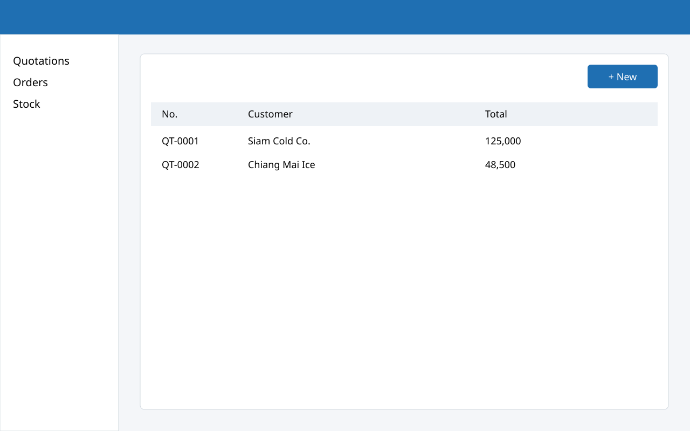
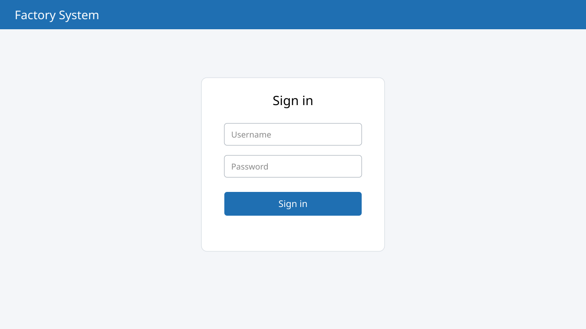

# ใบเสนอราคา {#quotation}

## รายการใบเสนอราคา {#quotation-list}

เมื่อเลือกเมนู “ใบเสนอราคา” ระบบจะแสดงรายการใบเสนอราคาทั้งหมด

{#fig-quotation}

จาก @fig-quotation แสดงหน้ารายการใบเสนอราคา ซึ่งประกอบด้วยหมายเลขที่ระบุดังนี้

1. แถบเมนูด้านซ้าย สำหรับเลือกเมนูต่าง ๆ ของระบบ
2. ปุ่ม “+ New” สำหรับสร้างใบเสนอราคาใหม่
3. ตารางแสดงเลขที่ ชื่อลูกค้า และยอดรวมของใบเสนอราคา

## การสร้างใบเสนอราคา {#quotation-new}

1. กดปุ่ม “+ New” ที่มุมขวาบนของหน้ารายการ
2. กรอกชื่อลูกค้าและรายการสินค้า
3. กดปุ่ม “บันทึก” ระบบจะสร้างเลขที่ใบเสนอราคาให้อัตโนมัติ

    {#fig-small width=50%}
