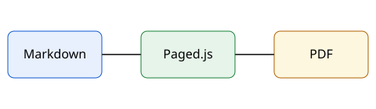

# Introduction {#intro}

This document explains how to install and use the sample system.

## Purpose {#goal}

The system lets a team write manuals in Markdown and export a PDF right away, without laying out pages by hand. See @fig-flow for an overview.

{#fig-flow width=60%}

## Requirements {#requirements}

The machine requirements are listed in @tbl-req and the steps are in @install.

| Item | Recommended |
|---|---|
| Memory | 8 GB |
| Free space | 20 GB |
| Operating system | Windows 11 |

: Machine requirements {#tbl-req}

### Note {#note}

Recommended values may change with the size of the document.
