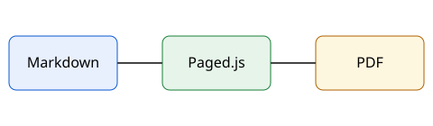

# บทนำ {#intro}

เอกสารฉบับนี้อธิบายวิธีการติดตั้งและใช้งานระบบตัวอย่างสำหรับผู้ใช้งานทั่วไป โดยใช้ภาษาไทยที่ไม่มีช่องว่างระหว่างคำ ทำให้ต้องอาศัยพจนานุกรมในการตัดคำเพื่อขึ้นบรรทัดใหม่ให้ถูกต้อง เช่น ประสิทธิภาพ สถาปัตยกรรม และความสามารถในการทำงานร่วมกัน

## วัตถุประสงค์ {#goal}

ระบบนี้ช่วยให้ทีมงานเขียนเอกสารคู่มือด้วย Markdown แล้วส่งออกเป็น PDF ได้ทันที โดยไม่ต้องจัดหน้าเอง ดูภาพรวมการทำงานได้ที่ @fig-flow

{#fig-flow width=60%}

## ข้อกำหนดเบื้องต้น {#requirements}

ข้อกำหนดของเครื่องแสดงใน @tbl-req และขั้นตอนการติดตั้งอยู่ใน @install

| รายการ | ค่าที่แนะนำ |
|---|---|
| หน่วยความจำ | 8 GB |
| พื้นที่ว่าง | 20 GB |
| ระบบปฏิบัติการ | Windows 11 |

: ข้อกำหนดของเครื่อง {#tbl-req}

### หมายเหตุ {#note}

ค่าที่แนะนำอาจเปลี่ยนตามขนาดของเอกสาร
