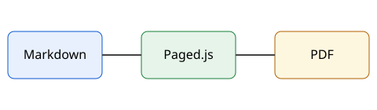

# Introduction {#intro}

This project is an example manual written in Markdown. Each language lives in its own folder (`th/` and `en/`) with the same file names. Press Recompile to get a PDF with a cover page, a table of contents and numbered headings.

## How it works {#overview}

Write the content in Markdown and the system lays out the pages and builds the PDF. See @fig-flow for the steps.

{#fig-flow width=60%}

## Facts to know {#facts}

@tbl-files lists the important files of the project.

| File | Purpose |
|---|---|
| `book.yaml` | Book title, author and chapter order |
| `th/` | Thai content |
| `en/` | English content |
| `assets/` | Shared images |

: Important project files {#tbl-files}
