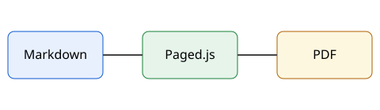

# บทนำ {#intro}

โปรเจกต์นี้เป็นตัวอย่างเอกสารคู่มือที่เขียนด้วย Markdown ทุกภาษาอยู่ในโฟลเดอร์ของตัวเอง (`th/` และ `en/`) โดยใช้ชื่อไฟล์เดียวกัน เมื่อกด Recompile จะได้ PDF ที่มีหน้าปก สารบัญ และเลขหัวข้อให้อัตโนมัติ

## ภาพรวมการทำงาน {#overview}

เขียนเนื้อหาเป็น Markdown ระบบจะจัดหน้าและสร้าง PDF ให้ ดูขั้นตอนใน @fig-flow

{#fig-flow width=60%}

## ข้อมูลที่ต้องรู้ {#facts}

ตารางที่ @tbl-files สรุปไฟล์สำคัญของโปรเจกต์

| ไฟล์ | หน้าที่ |
|---|---|
| `book.yaml` | ชื่อเล่ม ผู้จัดทำ และลำดับบท |
| `th/` | เนื้อหาภาษาไทย |
| `en/` | เนื้อหาภาษาอังกฤษ |
| `assets/` | รูปภาพที่ใช้ร่วมกัน |

: ไฟล์สำคัญของโปรเจกต์ {#tbl-files}
